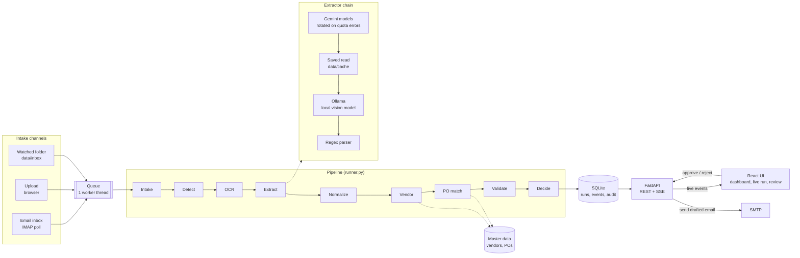
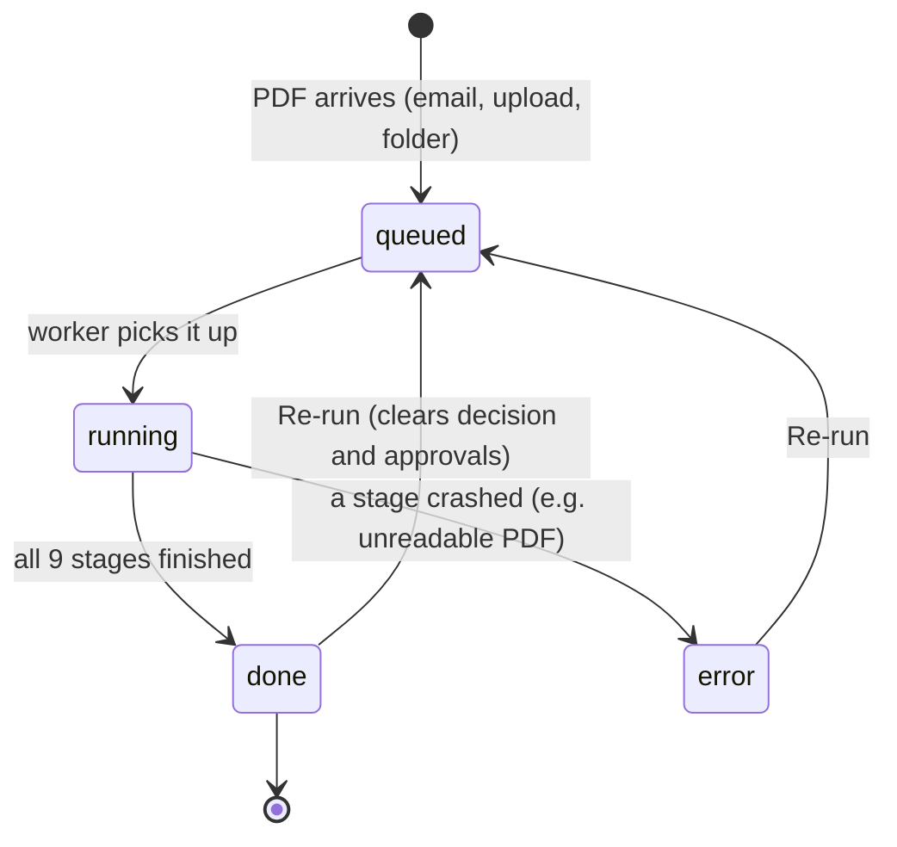
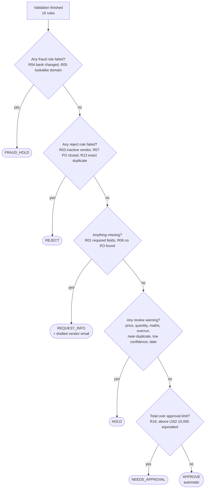
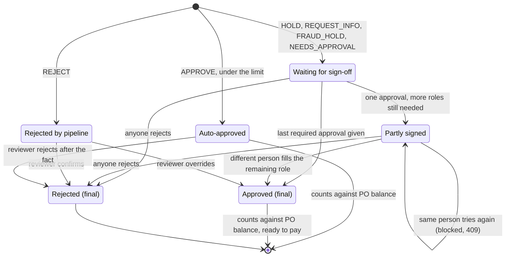

# AP Desk — Project Guide

A complete walkthrough of the invoice processing system: what problem it solves, how it is built, how every stage makes its decisions, and how to run, test, and extend it. It is written so that someone who has never seen the code can understand the whole project from this one document.

---

## Contents

1. [The problem](#1-the-problem)
2. [What the system does](#2-what-the-system-does)
3. [Quick start](#3-quick-start)
4. [Architecture](#4-architecture)
5. [The pipeline, stage by stage](#5-the-pipeline-stage-by-stage)
6. [Validation rules](#6-validation-rules)
7. [How the decision is made](#7-how-the-decision-is-made)
8. [Edge cases](#8-edge-cases)
9. [Intake channels](#9-intake-channels)
10. [The user interface](#10-the-user-interface)
11. [Data: master data, samples, history](#11-data-master-data-samples-history)
12. [Data model (database)](#12-data-model-database)
13. [API reference](#13-api-reference)
14. [Configuration](#14-configuration)
15. [Design decisions and trade-offs](#15-design-decisions-and-trade-offs)
16. [Testing](#16-testing)
17. [Repository map](#17-repository-map)
18. [Known limits and what's next](#18-known-limits-and-whats-next)
19. [Glossary](#19-glossary)

---

## 1. The problem

A mid-size company receives hundreds of vendor invoices a month as PDF attachments. Today an accounts-payable (AP) clerk does this for each one:

1. Opens the PDF.
2. Finds the matching purchase order (PO) in a spreadsheet.
3. Checks the numbers line up: prices, quantities, tax, totals.
4. Decides: pay it, hold it, ask the vendor for something, or reject it.

It is slow and repetitive, and mistakes are expensive: paying a duplicate, overpaying a PO, or wiring money to a fraudster who sent a "we changed our bank account" invoice.

The invoices are messy:

- **Formats vary by vendor.** Different layouts, labels and languages.
- **Some are scans.** There is no text inside the PDF, only a picture.
- **Tax varies.** Sometimes it's a separate line, sometimes it's already included in the prices.
- **PO references vary.** They may be printed, missing, or mistyped.
- **Fields go missing.** Sometimes there's no invoice number, date, or total.

Matching is not always obvious either. One PO can be billed across several invoices, amounts can be close but not exact, and the same invoice can be resubmitted under a new number.

**The goal:** take an invoice as input and produce a clear, reasoned decision as output, with everything that happened in between visible.

---

## 2. What the system does

```
PDF arrives  ──►  read it  ──►  understand it  ──►  check it  ──►  decide  ──►  explain
(email /          (text or      (fields, tax,       (vendor, PO,    (one of 5    (reasons,
 upload /          OCR)          amounts, dates)     15 rules)       outcomes)    next steps)
 folder)
```

Every invoice becomes a **run**. A run moves through **9 stages**. Each stage writes an event that the UI shows live. At the end the run gets one of five **decisions**:

| Decision | Meaning | What happens next |
|---|---|---|
| **Approve** | Every check passed | Ready for payment to the bank account on file; the PO balance is reduced |
| **Hold** | Something needs a human judgement call | Appears in the review queue with specific questions for the reviewer |
| **Request info** | The invoice is missing something only the vendor can provide | A draft email to the vendor is created; a person reviews it and sends it |
| **Reject** | Cannot be paid: duplicate, unknown or inactive vendor, closed PO | No payment, with the reason recorded |
| **Fraud hold** | Payment details can't be trusted: bank account changed, lookalike email domain | No payment and **no reply to the sender**; verify through the contact on file |
| **Awaiting approval** | Every data check passed, but the amount is above the auto-approval limit | A finance manager must approve before payment |

A reviewer can later approve or reject any held invoice, with a comment. That outcome is recorded in the audit trail and becomes the invoice's final status.

---

## 3. Quick start

**Requirements:** Windows with Python 3.12+ and Node 18+. The scripts are PowerShell, but the code is cross-platform.

```powershell
copy .env.example .env        # set GEMINI_API_KEY; optionally IMAP_USER / IMAP_PASSWORD
.\start.ps1
```

`start.ps1` does the following:

1. Creates `.venv` and installs `requirements.txt` (first run only).
2. Generates the sample invoice PDFs, if they're missing.
3. Builds the React UI, if it isn't built yet.
4. Starts the server at **http://127.0.0.1:8000**. The same server provides the API and the UI.

**Trying it:**

- **Intake page → Test invoices → Run.** Runs a prepared sample and opens its live view.
- **Drag a PDF anywhere** onto the page.
- **Copy a PDF into `data/inbox/`.** It's picked up within about 2 seconds.
- **Email a PDF** to the configured mailbox. It's picked up within the poll interval (20 s by default).
- **Intake page → Reset demo data.** Clears all runs and restores the history invoices.

**Development mode,** with hot reload:

```powershell
cd backend;  ..\.venv\Scripts\python -m uvicorn app.main:app --reload --port 8000
cd frontend; npm run dev          # http://localhost:5173, proxies /api to :8000
```

---

## 4. Architecture

```
                ┌──────────────────────── backend (FastAPI, Python) ─────────────────────────┐
 Email inbox ──►│ intake/email_intake.py ─┐                                                  │
 (IMAP poll)    │                         │                                                  │
 Upload (UI) ──►│ main.py /api/upload ────┼──► worker.py  ──►  pipeline/runner.py            │
                │                         │     (queue +       │                             │
 data/inbox/ ──►│ intake/folder.py ───────┘      1 thread)     ├─ documents.py  detect, OCR  │
 (watched)      │                                              ├─ extract.py    LLM chain    │
                │                                              ├─ normalize.py  clean, ground│
                │                                              ├─ vendor.py     vendor, fraud│
                │                                              ├─ match.py      PO matching  │
                │                                              ├─ rules.py      15 rules     │
                │                                              └─ decide.py     outcome      │
                │                                                     │                      │
                │   master.py (vendors, POs, live balances)   db.py (SQLite) ◄── events      │
                │                                                     │                      │
                │   main.py  REST + Server-Sent Events  ◄─────────────┘                      │
                └──────────────────────────────┬─────────────────────────────────────────────┘
                                               │ JSON + SSE
                ┌──────────────────────────────▼──────────────┐
                │ frontend (React + Vite + Tailwind)          │
                │ Dashboard · Live run · Intake · Review · POs│
                └─────────────────────────────────────────────┘
```

The same picture as a diagram (renders on GitHub):



With `CACHE_FIRST=1` the saved read is tried before Gemini (demo mode).

**Key building blocks**

| Piece | Technology | Why |
|---|---|---|
| Web server and API | FastAPI + Uvicorn | Simple, async-friendly, easy streaming responses |
| Storage | SQLite via SQLModel | Zero setup; enough for hundreds of invoices a month |
| Background processing | One worker thread with a queue | Invoices are processed one at a time in order, so there are no race conditions on PO balances |
| Live updates | Server-Sent Events (SSE) | One-way server-to-browser stream; simpler than WebSockets |
| PDF text | pdfplumber | Reliable text extraction from digital PDFs |
| PDF rendering | pypdfium2 | Turns PDF pages into images for OCR and vision models |
| OCR | RapidOCR (ONNX) | Runs locally on the CPU with a pip install and no system dependencies |
| Field extraction | Google Gemini, with fallbacks | Reads messy layouts; returns JSON |
| Fuzzy matching | rapidfuzz | Vendor names, line descriptions, lookalike domains |
| UI | React 18, Vite, Tailwind v4, lucide icons | Fast build, small bundle |

**One process.** FastAPI also serves the built UI from `frontend/dist`, so a single command runs everything.

---

## 5. The pipeline, stage by stage

The orchestrator is `backend/app/pipeline/runner.py`. Each stage:

1. Marks itself `started`, which shows a spinner in the UI.
2. Does its work.
3. Finishes with a status (`ok`, `warn`, `fail` or `skip`), a one-line title, and a `detail` object that the UI renders.

There is a small pacing delay (`STAGE_DELAY_MS`, 350 ms by default) so a human can follow the live view. Set it to `0` for raw speed.

### Stage 1 — Intake

- Reads the file and records its **SHA-256 fingerprint**. The same file submitted twice is caught later by rule R13.
- Records where it came from (`email`, `upload`, `folder`, `sample`) and, for email, the sender, subject, date and message ID.

### Stage 2 — Document type (`documents.py → detect`)

- Extracts the text layer with pdfplumber.
- If there are fewer than 40 characters per page, the PDF is treated as **scanned**, meaning it's an image only. That decides the route: text layer or OCR.

### Stage 3 — OCR (`documents.py → ocr`), scans only

- Renders each page at 220 dpi.
- RapidOCR finds text regions and returns each with a confidence score.
- Regions are regrouped into lines in reading order (top to bottom, then left to right).
- The UI shows the average confidence, the lowest-confidence words, and the reconstructed text.

For digital PDFs this stage is skipped, and it shows a preview of the text layer instead.

### Stage 4 — Field extraction (`extract.py`)

A language model reads the invoice and returns structured JSON:

```
vendor_name, vendor_email, vendor_tax_id, invoice_number, invoice_date, due_date,
po_number (only if printed), order_reference_hint, currency, bank_name, bank_account,
bank_change_notice, line_items[{description, sku, quantity, unit_price, amount}],
subtotal, tax_rate, tax_amount, tax_inclusive, total,
confidence{vendor_name, invoice_number, invoice_date, total, po_number, bank_account, line_items}
```

The prompt insists on copying values only, never inventing them, and using `null` for anything missing.

**What the model sees:**

- **Digital PDF:** the original PDF file.
- **Scan:** the page images plus the local OCR text as a hint.

**Extractor chain.** The first one that succeeds wins, and every attempt is shown in the UI:

| Order | Extractor | When it's used |
|---|---|---|
| 1 | `gemini-2.5-flash` | Default |
| 2–5 | `gemini-3.5-flash-lite`, `gemini-flash-lite-latest`, `gemini-2.5-flash-lite`, `gemini-3.8-flash` | If the previous model is out of quota (429), overloaded (503, retried once) or retired (404). Each model has its own free-tier quota |
| 4 | `cache` | The last successful Gemini result for the exact same file (matched by hash). Used only when every live model failed |
| 5 | `ollama` (local `qwen2.5vl:3b`) | Offline fallback, if Ollama is running and the model is pulled |
| 6 | `regex` | Last resort: label-based patterns. Lower confidence, so it's marked as a warning |

The LLM never decides anything. It only reads.

### Stage 5 — Normalize (`normalize.py`)

This stage turns what was read into clean, comparable values:

- **Amounts.** `1.234,56`, `1,234.56`, `€ 4.938,50` and `$6,863.05` all become plain numbers.
- **Dates.** Parsed in any format. If a date is ambiguous (`03/04/2026`), the locale is chosen from the currency: EUR, GBP and INR mean day-first. The ambiguity is noted.
- **Currency.** Symbols are mapped to ISO codes. If none is printed, the vendor's currency from master data is used, and that is noted.
- **Tax.** The aim is always a **net subtotal** comparable with PO prices, which are net:
  - Tax-inclusive invoices (for example "incl. 19% VAT"): the embedded tax is removed from the total and from each line price.
  - Missing subtotal or total: computed from the lines plus tax, and noted.
- **Emails.** Email addresses are taken **verbatim from the document text**, not from the model's output (see [design decisions](#15-design-decisions-and-trade-offs)).
- **Grounding.** For the invoice number, PO number, vendor email, bank account and total, the system checks whether the extracted value actually appears in the document text. If it doesn't, that field's confidence is lowered to 40%. This catches made-up values.

### Stage 6 — Vendor verification (`vendor.py`)

- **Finding the vendor.** The invoice's vendor is compared with every vendor in master data:
  - fuzzy name match, ignoring legal suffixes (`Inc`, `LLC`, `GmbH` and so on) and checking aliases;
  - exact tax ID match, which counts as 99%;
  - exact bank account match, which counts as 95%.

  The best match counts only if it scores at least 80%.
- **Bank account.** The account printed on the invoice is compared with the account on file, using alphanumeric characters only. The result is `match`, `mismatch`, or `missing` (missing is fine; payment goes to the account on file). The UI shows only the last 4 digits of each account.
- **Email domains.** Both the sender's domain and every domain printed on the invoice are compared with the vendor's official domain:
  - `exact`: same domain, or a subdomain of it.
  - `lookalike`: a "skeleton" comparison maps `1→l`, `0→o`, `3→e`, `5→s` and `rn→m`, then fuzzy-matches at 85% or above. For example, `acme-supp1ies.com` is a lookalike of `acmesupplies.com`.
  - `different`: an unrelated domain.
- It also records whether the invoice announces "new bank details".

### Stage 7 — PO matching (`match.py`)

1. **Explicit.** If a PO number is printed (tolerating OCR slips like `P0-1003`) and exists, use it.
2. **Inferred.** If no PO is printed, or the printed one doesn't exist, every **open** PO for this vendor is scored:

   ```
   score = 0.55 × line-description similarity
         + 0.25 × share of lines whose unit price is within ±2% of the PO
         + 0.20 × does the invoice fit within the PO's remaining balance
   ```

   The best PO is accepted if its score is at least **0.72**. All candidates and their scores are shown in the UI.

3. **Line matching.** Each invoice line is matched to a PO line, by SKU if present, otherwise by fuzzy description (at least 60% similarity). For each line the system records the price difference in percent and the **remaining quantity**: PO quantity minus quantities already billed on approved invoices.

PO balances are always computed live from approved runs (`master.py → po_consumption`). Nothing is stored twice.

### Stage 8 — Validation rules (`rules.py`)

15 deterministic checks. See [section 6](#6-validation-rules).

### Stage 9 — Decision (`decide.py`)

This stage turns the rule results into a decision, a headline, an explanation, next steps and, when needed, a draft email. See [section 7](#7-how-the-decision-is-made).

---

## 6. Validation rules

Each rule returns:

- `status`: `pass`, `warn`, `fail` or `skip`;
- a human-readable `message`;
- for non-passing results, an **outcome class** that says what kind of problem it is.

| ID | Rule | Checks | Outcome if not passed |
|---|---|---|---|
| R01 | Required fields present | Vendor, invoice number, date and total exist | request info |
| R02 | Extraction confidence | Invoice number, date and total read with ≥ 75% confidence | review |
| R03 | Approved vendor | The vendor is in master data and active | reject |
| R04 | Bank details match master | The bank account on the invoice equals the one on file | **fraud** |
| R05 | Sender domain authentic | Sender and invoice email domains match the vendor's domain | lookalike → **fraud**; different → review |
| R06 | Purchase order identified | A PO is printed and exists, or is inferred with score ≥ 0.72 | request info |
| R07 | PO open and owned by vendor | The PO isn't closed and belongs to this vendor | closed → reject; wrong vendor → review |
| R08 | Currency matches PO | Invoice currency equals PO currency | review |
| R09 | Unit prices within ±2% | Every line's net unit price is within tolerance of the PO price, and every line is on the PO | review |
| R10 | Quantities within remaining PO quantity | Billed quantity ≤ quantity left after earlier approved invoices | review |
| R11 | Invoice arithmetic | Lines add up to the subtotal, subtotal + tax = total, and tax = rate × subtotal | review |
| R12 | PO balance not exceeded | Earlier invoices + this invoice ≤ PO value × (1 + 2%) | review |
| R13 | Not an exact duplicate | No earlier run with the same file hash, or the same vendor + invoice number | reject |
| R14 | Not a near-duplicate | No earlier invoice from the same vendor with amount within 1% and date within 14 days but a different number | review |
| R15 | Invoice date plausible | Not in the future, and not older than 180 days | review |
| R16 | Within auto-approval limit | Total, converted to USD at fixed rates, is ≤ `APPROVAL_LIMIT_USD` (10,000) | approval (finance manager sign-off) |

The tolerances (price 2%, amount 2%) are configurable in `.env`. The other thresholds are in `backend/app/config.py`.

---

## 7. How the decision is made

**Step 1 — Pick the most severe outcome.** Collect every rule that warned or failed, then take the most severe outcome class present:

```
fraud  >  reject  >  request_info  >  review  >  approval  >  (nothing)
  │         │            │              │           │             │
FRAUD_HOLD REJECT   REQUEST_INFO      HOLD    NEEDS_APPROVAL    APPROVE
```

("approval" comes only from R16: everything passed, but the total is over the approval limit.)

The flowchart and state diagrams under [State diagrams](#state-diagrams) show the same logic visually.

**Step 2 — Build the explanation.**

| Decision | Headline | "Why" | "Next steps" |
|---|---|---|---|
| Approve | "Approve INV-… from … for USD …" | Number of checks passed; inferred-PO note; tax note | Pay to the account on file per payment terms; book against the PO, with the remaining balance |
| Fraud hold | "Fraud hold: … payment details can't be trusted" | The failing fraud rules | Do not pay and do not reply to the sender; verify by phone through the contact on file; escalate |
| Reject | "Reject …" | The failing rule | Depends on the reason: duplicate → point to the original run; unknown vendor → onboarding; closed PO → raise a new PO |
| Request info | "Need info from … before … can be processed" | Missing fields or PO | Review and send the drafted email |
| Hold | "Hold … for review" | Every warning | One specific question per issue, for example *"PO would be overrun — approve the overrun, pay up to the PO balance, or ask for a PO amendment?"* |

**Step 3 — Draft the vendor email** (Request info only):

- **Recipient:** the email sender, if their domain is exactly the vendor's; otherwise the contact email on file.
- **Contents:** a polite request listing exactly what's missing.
- It is **never sent automatically.** A person edits it if needed and clicks *Send email*. It goes out over SMTP as a reply in the same thread.

**Human sign-off (approval policy).** Each decision comes with a list of required approvals. Each approver enters a name and a role, and **one person can fill only one requirement** (the four-eyes rule).

| Case | Sign-off needed |
|---|---|
| Clean, under the limit | none (auto-approved) |
| Clean, over the limit | Finance manager |
| Hold / Request info, under the limit | AP reviewer (any role) |
| Hold / Request info, over the limit | AP reviewer **and** Finance manager, two different people |
| Fraud hold, any amount | AP reviewer **and** Finance manager, two different people |

A rejection by anyone rejects the invoice. Once every requirement is filled, the **effective decision** becomes Approve and the invoice counts against the PO balance. Every approval is recorded in the audit trail with the approver's name and role.

### State diagrams

**1. Processing state of a run** (`Run.status`). This is about the machine, not the invoice: did the pipeline finish?



**2. Which decision the pipeline gives.** Every rule that warns or fails carries an outcome class. The most severe class present wins; the order is fixed.



**3. What happens after the decision** (`Run.review_status` and approvals). This is the human part: who must sign before the invoice is paid.



Required roles per decision (from `decide.py → required_approvals`):

| Decision | Under limit | Over limit |
|---|---|---|
| APPROVE | nobody | — (becomes NEEDS_APPROVAL) |
| NEEDS_APPROVAL | — | Finance manager |
| HOLD / REQUEST_INFO | AP reviewer | AP reviewer + Finance manager |
| FRAUD_HOLD | AP reviewer + Finance manager | AP reviewer + Finance manager |
| REJECT | nobody (one reviewer approval overrides it) | same |

A finance manager can fill the reviewer step too, but one person can fill only one step, so two-step cases always need two different names.

---

## 8. Edge cases

Four deliberately hard scenarios are included as sample PDFs, along with two simpler ones.

### Edge case 1 — Bank details changed, from a lookalike domain
`data/samples/02_acme_INV-AC-55102_bank_change.pdf` · Expected: **Fraud hold**

- **Setup:** Acme Industrial Supplies. Correct PO (PO-1002), correct items, prices and math. The invoice says *"Our banking details have changed… remit to the new account below"*, and the contact email is `accounts@acme-supp1ies.com` (the digit 1 in place of the letter l).
- **Why it's hard:** every business check passes. A tired reviewer approves it. This is the classic business email compromise attack.
- **What happens:**
  - R04 fails: the account on file ends `3456`, the invoice says `9934`.
  - R05 fails: the domain is a lookalike.
  - The decision is Fraud hold, and the UI shows a side-by-side "on file vs on this invoice" panel.
  - It deliberately **does not reply to the sender**, because that channel may be the attacker.
- **Lesson learned while building:** Gemini silently "corrected" `acme-supp1ies.com` to `acme-supplies.com` in its output. That's why domain checks read the raw document text, not the model's answer.

### Edge case 2 — Scanned, no PO number, VAT-inclusive, German, EUR
`data/samples/03_brightline_scan_RE-2026-1187.pdf` · Expected: **Approve**

- **Setup:** Brightline Logistics GmbH. An image-only scan, slightly rotated and noisy. German labels, day-first dates (`14.11.2026`), European number format (`4.938,50 €`), and prices that include 19% VAT. No PO number printed, only "Transporte HH-RTM KW 45/46".
- **Why it's hard:** no text layer. Line prices don't match the PO because they include tax. And this vendor has two open POs (freight on PO-1003, warehousing on PO-1007).
- **What happens:**
  - OCR reads the scan.
  - Gemini extracts the fields.
  - Normalization removes the embedded tax: total 4,938.50, minus 788.50 VAT, gives 4,150.00 net, and the unit prices become net.
  - PO inference scores PO-1003 at 0.85 against PO-1007 at 0.39.
  - All rules pass and the invoice is approved, with the inference visible in the trace.

### Edge case 3 — The third invoice on a split PO overruns it
`data/samples/04_cobalt_INV-C-0577_split_po.pdf` · Expected: **Hold**

- **Setup:** PO-1004 is 120 consulting hours at $150, so $18,000. History already holds two approved invoices: 40 h ($6,000) and 45 h ($6,750). The new invoice bills 42 h ($6,300).
- **Why it's hard:** on its own the invoice is perfect. The problem only shows when you add up everything billed against the PO.
- **What happens:**
  - R10: 42 h billed, but only 35 h remain.
  - R12: the PO reaches $19,050, which is $1,050 (5.8%) over a tolerance of 2%.
  - The decision is Hold. The UI shows a PO balance bar (earlier invoices, this invoice, overrun in red) with links to the earlier invoices.
  - The reviewer is asked whether to approve the overrun, pay up to the balance, or ask for a PO amendment.

### Edge case 4 — Near-duplicate resubmission
`data/samples/05_pixelpine_PP-2297_resubmission.pdf` · Expected: **Hold**

- **Setup:** Pixel & Pine already billed "Milestone 2" as PP-2291 on 9 Nov (approved). Five days later, PP-2297 arrives: same milestone, same $4,800, a **different invoice number** and a **different template**.
- **Why it's hard:** an exact duplicate check (vendor + invoice number) misses it completely.
- **What happens:**
  - R14 finds the same vendor, an amount within 0%, 5 days apart, and 100% line overlap.
  - R10 confirms that Milestone 2 has no quantity left.
  - The decision is Hold, with a link to the earlier invoice for side-by-side comparison.

### Field highlighting (click to see where it was read)
In the **Field extraction** stage every value is clickable. The page images show a highlight box where that value appears on the document:
- **Digital PDFs:** the position comes from the PDF's text layer (`pdfplumber` search).
- **Scans:** the position comes from the OCR word boxes saved during the OCR stage.

Numbers are searched in all common print formats (`6,863.05`, `6.863,05`, `6863.05`). If the value can't be found, the UI says so, which is itself a useful warning.

### Simpler scenarios

| Sample | Expected | Shows |
|---|---|---|
| `01_northwind_INV-NW-88213.pdf` | Approve | Happy path: clean digital PDF, explicit PO, separate sales tax |
| `06_northwind_missing_invoice_number.pdf` | Request info | Missing invoice number; a draft email to the vendor is created |
| `07_helix_HLX-30091_inactive_vendor.pdf` | Reject | The vendor exists but is inactive |

| `08_northwind_INV-NW-88302_over_limit.pdf` | Awaiting approval | Clean invoice for USD 22,516, above the USD 10,000 limit |
| `09_sunrise_SPL-2026-0419_gst.pdf` | Approve | India: GST split into CGST + SGST, Indian number format `2,69,040.00`, INR |
| `10_nordic_scan_NFC-7781.pdf` | Approve | **Scan**, Finnish catering, 14% VAT, day-first dates, EUR |
| `11_atlas_scan_AFS-30344_price_increase.pdf` | Hold | **Scan**, more skewed and noisy; monthly service billed 5% above the PO price (R09) |
| `12_quantum_QPS-5520_extra_charge.pdf` | Hold | An extra "rush fee" line that isn't on the PO (R09) |
| `13_greenleaf_GL-88120_partial_gbp.pdf` | Awaiting approval | Partial delivery (10 of 25 laptops) in GBP; GBP 11,400 ≈ USD 14,478 is over the limit after conversion |

A further behaviour comes for free: send any invoice twice and R13 rejects the second copy as an exact duplicate.

---

## 9. Intake channels

All three channels create a run the same way (`worker.create_run`) and go through the same pipeline.

### Upload
- **Where:** the Intake page (file picker or drop zone), or **drag a PDF anywhere** in the app.
- **Endpoint:** `POST /api/upload`. Several files are accepted; non-PDFs are refused.

### Watched folder
- **Folder:** `data/inbox/`, checked every 2 seconds.
- A file is only picked up once its size has stopped changing, so half-copied files are never read.
- After pickup the file moves to `data/processed/`.
- Use it by pointing a scanner, a shared drive or a sync tool at this folder.

### Email
- A dedicated Gmail mailbox, checked over IMAP every `IMAP_POLL_SECONDS` (default 20).
- **Unread** emails are fetched. Every PDF attachment becomes a run, and the email is then marked as read.
- Sender, subject, date and message ID are stored on the run.
- **Internally forwarded mail:** if the sender *is* the AP mailbox itself (an AP clerk forwarding an invoice), the sender-domain check is skipped, because the sender is our own team, not the vendor. Domains printed **on the invoice** are still checked.
- **Outgoing emails** (vendor info requests) use SMTP with the same credentials.

**Setting up Gmail:**

1. Create a dedicated Gmail account and turn on 2-step verification.
2. Go to Google Account → Security → **App passwords** and create one (16 characters).
3. In `.env`, set `IMAP_USER=<address>` and `IMAP_PASSWORD=<app password>`.
4. Restart the server. The Intake page then shows "Listening".

`scripts/send_test_emails.py 01 03` emails sample invoices to the mailbox, which is handy for demos.

---

## 10. The user interface

Design idea: an **AP desk**. The palette is ledger grey with carbon-copy blue ink. Pipeline stages are drawn as a paper **routing slip**, and the decision lands as a **rubber stamp** (APPROVED / HOLD / INFO NEEDED / REJECTED / FRAUD HOLD). It supports light and dark mode, works down to phone width, and respects reduced-motion settings.

### Dashboard (`/`) — "Invoice ledger"
- **Ledger strip:**
  - processed count;
  - auto-approval rate;
  - invoices needing attention, with their value;
  - fraud blocked, by value;
  - average time from PDF to decision.
- **Decision mix:** a stacked bar showing the share of each outcome.
- **Processing now:** live chips for invoices currently running.
- **Runs table:**
  - filter by decision (All, Needs attention, Approved, On hold, …), by source, or by text search;
  - rows update and flash live as invoices progress;
  - a scan icon marks scanned documents;
  - a toggle reveals the pre-loaded history invoices.

### Live run view (`/runs/:id`)
- **Header:** vendor, invoice number, source, sender and subject (for email), and total duration.
- **Routing slip (left):** the 9 stages, each with a status icon, a one-line result and its timing. While running it follows the current stage automatically; click any finished stage to inspect it.
- **Stage detail (centre).** Each stage has its own view:

  | Stage | What the view shows |
  |---|---|
  | OCR | Confidence meter, low-confidence words, reading-order text |
  | Extraction | The extractor chain (for example `gemini-2.5-flash ✗ quota → gemini-2.5-flash-lite ✓`); every field with a confidence bar |
  | Normalize | Net / tax / total cards, normalization notes, grounding checks |
  | Vendor | Master record, bank on file vs on invoice, email domains with a match label |
  | PO matching | Inferred-PO candidate scores, PO balance bar with overrun, line-by-line match table (quantity vs remaining, unit price vs PO) |
  | Validation | All 15 rules |

- **Decision panel**, shown when the run finishes:
  - the stamp lands with a short animation;
  - headline, "Why" and "Next steps";
  - a fraud comparison panel, when relevant;
  - the review box (approve or reject with a comment);
  - the vendor email draft editor (edit, send, discard);
  - all checks and the full audit trail.
- **Source document (right, or below on smaller screens):** the original PDF.

### Intake (`/intake`)
- **Status cards** for Upload, Email inbox (mailbox, last check, number picked up, errors) and Watched folder (path, last scan).
- **Extraction chain status:** whether a Gemini key is set, and the fallbacks available.
- **Test invoices:** the 7 samples, each with its expected decision and a **Run** button.
- **Reset demo data.**

### Review queue (`/review`)
- Everything waiting on a person: fraud holds first, then holds, then info requests.
- Each item shows the issues as chips and the first suggested action.
- A list of vendor email drafts waiting to be sent.

### Purchase orders (`/orders`)
- Every PO with a live **invoiced vs total** bar, per-line invoiced and ordered quantities, and links to the invoices booked against it.
- A table of approved vendors: email domain, masked bank account, terms, status.

---

## 11. Data: master data, samples, history

### Master data (`data/master/`)
This stands in for the procurement system. Edit the JSON files to change it; restart the server afterwards.

- **`vendors.json`:** 11 vendors (one inactive) across the US, Germany, the UK, Finland and India. Each has an ID, legal name, aliases, official email domain, contact email, tax ID, currency, bank name and account, payment terms, and status.
- **`purchase_orders.json`:** 14 POs (one closed). Each has a PO number, vendor, currency, issue date, status, and lines (SKU, description, quantity, unit price). The PO total is computed from the lines.

| PO | Vendor | Contents | Used by |
|---|---|---|---|
| PO-1001 | Northwind | Paper, toner, chairs ($6,340) | Happy path |
| PO-1002 | Acme | Gloves, hard hats, vests ($3,150) | Fraud case |
| PO-1003 | Brightline | Freight + customs (€8,300) | Scan / inferred PO |
| PO-1007 | Brightline | Warehousing (€7,680) | The decoy candidate for inference |
| PO-1004 | Cobalt | 120 h consulting ($18,000) | Split PO overrun |
| PO-1005 | Pixel & Pine | 3 brand milestones ($14,400) | Near-duplicate |
| PO-1006 | Northwind | Monitors, arms ($3,347) | Missing invoice number |
| PO-0987 | Acme | Closed | Available for a closed-PO test |

### Sample invoices (`data/samples/`)
- Generated by `scripts/generate_invoices.py` using reportlab, in 4 visually different layouts (classic, modern colour band, monospace minimal, German).
- The scan is made by rasterizing, rotating 0.9°, adding noise and specks, blurring, compressing as JPEG, and saving as an image-only PDF.
- `manifest.json` lists each sample's title, scenario, simulated sender, expected decision and total.

### History (`backend/app/seed.py`)
Four invoices are pre-loaded as approved in earlier months:

- Cobalt INV-C-0418 and INV-C-0502;
- Pixel & Pine PP-2240 and PP-2291.

They give the cumulative checks (R10, R12, R14) real context, just like a live system with past data. They are hidden on the dashboard unless "Show history" is ticked, and excluded from the stats.

---

## 12. Data model (database)

SQLite file: `data/app.db`, defined in `backend/app/db.py`.

| Table | Purpose | Key fields |
|---|---|---|
| `Run` | One invoice processing run | source, source_meta, filename, file_hash, status, current_stage, **decision**, headline, explanation, next_actions, rules, extractor, doc_type, extracted, normalized, match, vendor_id, invoice_number, invoice_date, po_number, currency, subtotal, total, duration_ms, **review_status**, review_comment |
| `RunEvent` | Stage events streamed to the UI | run_id, stage, status, title, detail (JSON), duration_ms |
| `EmailDraft` | Vendor emails | run_id, to, subject, body, in_reply_to, status (draft / sent / discarded / failed) |
| `AuditLog` | Who did what, when | run_id, actor (system / reviewer), action, note |

**Effective decision** = the reviewer's choice if the invoice was reviewed, otherwise the system's decision.

**PO balance** = the sum of subtotals of runs whose effective decision is Approve, for that PO. It's computed live and never stored.

---

## 13. API reference

All endpoints are under `/api`. Responses are JSON unless noted.

| Method | Path | Purpose |
|---|---|---|
| GET | `/runs` | All runs (summaries), newest first |
| GET | `/runs/{id}` | Full run: rules, extracted data, events, drafts, audit |
| GET | `/runs/{id}/file` | The original PDF |
| GET | `/runs/{id}/stream` | **SSE**: `stage` events as they happen, then `done` with the full run |
| GET | `/stream` | **SSE**: a `run` event whenever any run changes (powers the live dashboard) |
| POST | `/upload` | Multipart `files[]`, one or more PDFs, returns `{run_ids}` |
| POST | `/runs/{id}/review` | `{action: "approve" \| "reject", comment}` |
| POST | `/runs/{id}/rerun` | Re-process a run from scratch |
| GET | `/drafts` | All vendor email drafts |
| PATCH | `/drafts/{id}` | Edit `to`, `subject`, `body` |
| POST | `/drafts/{id}/send` | Send over SMTP |
| POST | `/drafts/{id}/discard` | Discard |
| GET | `/vendors` | Vendor master |
| GET | `/pos` | POs with live invoiced and remaining amounts and quantities |
| GET | `/stats` | Dashboard numbers (excludes history) |
| GET | `/intake` | Email, folder and extractor status, queue size |
| GET | `/samples` | Sample invoices from the manifest |
| POST | `/samples/{file}/run` | Run a sample, with its simulated sender |
| POST | `/admin/reset` | Delete all runs and re-seed history |

---

## 14. Configuration

`.env` in the project root. **Never commit it**; it is in `.gitignore`. `.env.example` is the template.

| Variable | Default | Meaning |
|---|---|---|
| `GEMINI_API_KEY` | — | Google AI Studio key. Without it the chain starts at Ollama, then regex |
| `GEMINI_MODEL` | `gemini-2.5-flash` | First model to try |
| `GEMINI_MODELS` | `gemini-2.5-flash,gemini-3.5-flash-lite,gemini-flash-lite-latest,gemini-2.5-flash-lite,gemini-3.8-flash` | Rotation order when a model is out of quota, overloaded or retired |
| `GEMINI_TIMEOUT_S` | `40` | Per-call timeout before moving to the next model |
| `APPROVAL_LIMIT_USD` | `10000` | R16: invoices above this (USD equivalent) need finance manager sign-off |
| `OLLAMA_URL` / `OLLAMA_MODEL` | `http://127.0.0.1:11434` / `qwen2.5vl:3b` | Optional local fallback |
| `IMAP_HOST` / `IMAP_USER` / `IMAP_PASSWORD` | `imap.gmail.com` / — / — | Email intake. Both user and password are needed to enable it |
| `IMAP_POLL_SECONDS` | `20` | How often the inbox is checked |
| `SMTP_HOST` / `SMTP_PORT` | `smtp.gmail.com` / `587` | For sending vendor emails |
| `STAGE_DELAY_MS` | `350` | Minimum visible time per stage in the live view (0 = no pacing) |
| `PRICE_TOLERANCE_PCT` | `2` | R09 unit price tolerance |
| `AMOUNT_TOLERANCE_PCT` | `2` | R12 PO overrun tolerance |

Fixed thresholds in `backend/app/config.py`:

| Constant | Value | Used by |
|---|---|---|
| `CONFIDENCE_THRESHOLD` | 0.75 | R02 |
| `PO_INFER_THRESHOLD` | 0.72 | PO inference |
| `FUZZY_DUP_AMOUNT_PCT` | 1.0 | R14 |
| `FUZZY_DUP_DAYS` | 14 | R14 |
| `MAX_INVOICE_AGE_DAYS` | 180 | R15 |

---

## 15. Design decisions and trade-offs

**1. The LLM reads; rules decide.**
The model turns a messy document into fields, and that's all it does. Every decision comes from deterministic rules with IDs and messages. This makes decisions:

- **explainable:** every outcome points to a rule;
- **reproducible:** the same data gives the same decision;
- **auditable:** finance teams and auditors can review the rules;
- **safe:** a model's "creativity" cannot approve a payment.

**2. Don't trust the extractor blindly.**

- **Confidence:** the model reports per-field confidence, and low confidence on critical fields triggers a review.
- **Grounding:** extracted values must be found in the actual document text, or their confidence drops.
- **Security-critical fields come from raw text.** During testing, Gemini quietly normalized a typo-squatted domain (`acme-supp1ies.com` became `acme-supplies.com`). Fraud checks therefore never rely on model output for domains.

**3. Severity-ordered outcomes, not a score.**
Rather than a single risk score with an arbitrary cut-off, each rule belongs to a class: fraud, reject, request info, or review. The most severe class wins. A fraud signal can't be outvoted by fifteen passing checks.

**4. Fraud handling is different from other holds.**
For fraud, the system *does not* draft a reply to the sender, because the attacker may control that mailbox. The next step is out-of-band verification through the contact already on file.

**5. Cumulative context matters.**
Several real problems are invisible on a single invoice: split POs, overruns, resubmissions. PO balances and duplicate checks therefore look across all earlier approved invoices. History is seeded so this works from the first demo run.

**6. Humans stay in the loop where judgement is needed.**
Holds come with *specific questions*, not just "needs review". Vendor emails are drafted, never auto-sent. Reviewer decisions are recorded in the audit trail and become the final status.

**7. Resilience over perfection.**
The extractor chain (several Gemini models, then cache, then a local model, then regex) means the pipeline always produces a result, and the trace always says which extractor ran and why the others failed.

**8. One worker, in order.**
Processing invoices one at a time removes race conditions on PO balances: two invoices against the same PO can't both see the same "remaining" amount. That's fine at this volume. At scale you would lock per PO instead.

**9. Simple infrastructure.**
SQLite, one Python process and server-sent events. Nothing to install beyond Python and Node, which suits a demo and a small team.

---

## 16. Testing

**End-to-end sample check**, with no UI and no pacing:

```powershell
.venv\Scripts\python scripts\run_samples.py        # resets DB, runs all 7 samples, compares to expected
.venv\Scripts\python scripts\run_samples.py -v     # also prints every warn/fail rule
```

Expected output: `7/7 matched expectations`. Each line also shows which extractor was used.

**Email path:**

```powershell
.venv\Scripts\python scripts\send_test_emails.py 01 02
```

Then watch the dashboard. If you send the same invoice again, R13 rejects it as a duplicate; that is correct behaviour.

**UI screenshots**, a dev helper that drives the installed Edge through Playwright:

```powershell
.venv\Scripts\python scripts\snap.py <out_dir> /=dashboard /runs/5=run5 [--dark] [--w=390]
```

---

## 17. Repository map

```
.
├── README.md                     Short overview
├── docs/PROJECT_GUIDE.md         This document
├── start.ps1                     One-command setup + run
├── requirements.txt              Python dependencies (pinned)
├── .env.example                  Configuration template (copy to .env)
├── backend/app/
│   ├── main.py                   FastAPI app: REST, SSE streams, serves UI
│   ├── config.py                 Settings and thresholds
│   ├── db.py                     SQLite tables: Run, RunEvent, EmailDraft, AuditLog
│   ├── master.py                 Vendors, POs, live PO balances
│   ├── worker.py                 Background queue; creates runs from any source
│   ├── seed.py                   History invoices; demo reset
│   ├── intake/
│   │   ├── email_intake.py       IMAP polling, SMTP sending
│   │   └── folder.py             Watched folder
│   └── pipeline/
│       ├── runner.py             Orchestrates the 9 stages, emits events
│       ├── documents.py          Text-layer detection, page rendering, OCR
│       ├── extract.py            LLM extraction chain + regex fallback + cache
│       ├── normalize.py          Amounts, dates, currency, tax, grounding
│       ├── vendor.py             Vendor resolution, bank and domain checks
│       ├── match.py              PO matching (explicit / inferred), line matching
│       ├── rules.py              The 15 validation rules
│       └── decide.py             Decision, explanation, next steps, email draft
├── frontend/
│   ├── index.html, vite.config.js, package.json
│   └── src/
│       ├── App.jsx               Layout, navigation, live runs feed, drag and drop
│       ├── api.js                API client
│       ├── index.css             Design tokens (light/dark), stamp, routing slip
│       ├── components/ui.jsx     Stamp, chips, status icons, money formatting
│       └── pages/                Dashboard, RunView, Intake, Review, Orders
├── data/
│   ├── master/                   vendors.json, purchase_orders.json
│   ├── samples/                  Test PDFs, history PDFs, manifest.json
│   ├── inbox/                    Watched folder (drop PDFs here)
│   ├── uploads/, processed/      Stored files (gitignored)
│   └── app.db                    Database (gitignored, created on first run)
└── scripts/
    ├── generate_invoices.py      Builds the sample PDFs
    ├── run_samples.py            End-to-end expectation check
    ├── send_test_emails.py       Emails samples to the AP inbox
    └── snap.py                   UI screenshots (dev helper)
```

---

## 18. Known limits and what's next

| Limit | Production answer |
|---|---|
| SQLite and a single worker | Postgres plus a task queue (Celery or RQ) with per-PO locking |
| Line items matched by fuzzy text | Learn each vendor's SKU-to-PO-line mapping from approved history |
| Master data in JSON files | Connect to the ERP or procurement system (SAP, NetSuite, Coupa) through its API |
| Two-way match (invoice ↔ PO) | Three-way match: add goods receipts, so you only pay for what was delivered |
| Gemini free-tier rate limits | Paid tier, or batch processing; the fallback chain already keeps it working |
| One currency per PO, no FX | FX conversion with a rate on the invoice date |
| Single page focus (OCR caps at 3 pages) | Multi-page invoices with continuation tables |
| No login or roles | SSO; separate approver roles and approval limits by amount |
| Fraud checks: bank + domain | Add vendor-bank-change workflows, IBAN/routing validation, and sanctions screening |

---

## 19. Glossary

| Term | Meaning |
|---|---|
| **AP (accounts payable)** | The team and process that pays a company's suppliers |
| **PO (purchase order)** | The buyer's approved order: what was ordered, how many, at what price |
| **Two-way match** | Checking an invoice against its PO (prices, quantities) |
| **Split PO** | One PO billed across several invoices over time |
| **Tolerance** | Acceptable difference before a mismatch is flagged (here 2%) |
| **Tax-inclusive** | Prices that already contain VAT or sales tax |
| **Net / gross** | Amount before / after tax |
| **OCR** | Optical character recognition: reading text from an image |
| **Text layer** | The machine-readable text inside a digital PDF; scans don't have one |
| **Grounding** | Verifying that an extracted value actually appears in the source document |
| **Lookalike (typo-squatted) domain** | A domain made to resemble a real one (`acme-supp1ies.com` vs `acmesupplies.com`) |
| **BEC (business email compromise)** | Fraud in which attackers impersonate a vendor, often to change bank details |
| **SSE (Server-Sent Events)** | A browser standard for a one-way live stream from server to page |
| **Run** | One invoice going through the pipeline |
| **Effective decision** | The final status: the reviewer's decision if reviewed, otherwise the system's |
